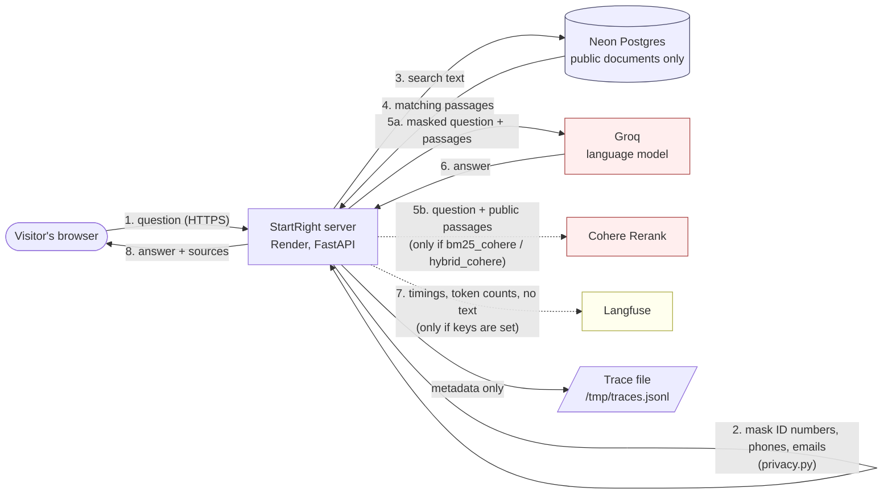

# Data-flow diagram

What happens to a visitor's question, and which third parties receive what.
GitHub renders the diagram below; to export an image, paste it into mermaid.live.

Red boxes are third parties that receive text derived from the visitor's question.

## What each system receives

| System | Receives | Does not receive | Stored by us? |
|---|---|---|---|
| Our server (Render) | The question as typed (in memory while answering) | n/a | Not saved. Only sizes and timings are kept. |
| Neon (database) | A search query over public documents (the question text, in the query) | Visitor identity | The documents are public legal texts; no visitor data is stored |
| **Groq** (language model) | The **masked** question and the retrieved public passages | Raw ID numbers, phone numbers, emails (masked first) | No. Check Groq's own retention terms. |
| **Cohere** (optional reranker) | The question and the candidate passages | Visitor identity. Masked text only (masking happens before search). | No. Check Cohere's retention terms. |
| **Langfuse** (optional) | Trace structure: step names, timings, token counts, cost, outcome | Question and answer text | Yes, at Langfuse (metadata only) |
| Guardrails AI (optional, local) | Nothing leaves the machine; its usage tracing is turned off and tested | n/a | No |

## Personal data

- **Collected on purpose:** none. The page asks visitors not to type personal details.
- **Collected by accident:** a visitor might type an ID number, a phone number or an email. Those three
  are replaced with `[ID number]`, `[phone number]` and `[email address]` on the server **before** any
  search or model call (`src/startright/privacy.py`, tests in `tests/test_privacy.py`).
- **Not caught:** names, street addresses and free-text details such as "my employee John Moyo at 12 Samora
  Machel". Patterns cannot catch these. They would reach Groq. This is a known limit, stated to users.
- **IP addresses:** used in memory for the hourly rate limit and not written to the trace file.

## Where the data lives

| Data | Location | Retention |
|---|---|---|
| Public documents and embeddings | Neon (US East) | Until we delete them |
| Rate-limit counters, daily token count | Server memory | Lost on restart |
| Trace file (metadata) | `/tmp/traces.jsonl` in the container | Lost on restart |
| Secrets | Render dashboard environment variables; `.env` locally (ignored by Git) | See `docs/secrets-audit.md` |
